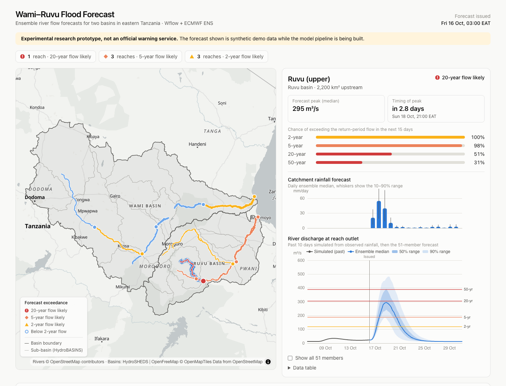
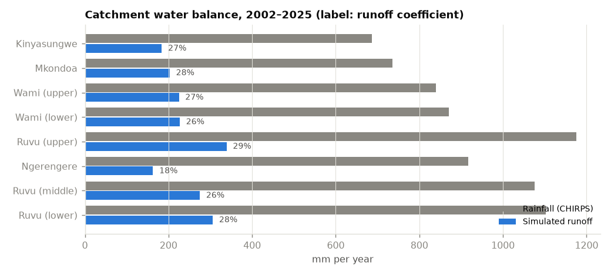

# Wami–Ruvu Flood Forecast

**[▶ Open the live dashboard](https://alvaroprida.github.io/wami-ruvu-flood-forecast/)**

[](https://github.com/alvaroprida/wami-ruvu-flood-forecast/actions/workflows/deploy-pages.yml)
[](LICENSE)

Experimental ensemble river-flow forecasting for the **Wami** and **Ruvu** basins in eastern Tanzania.
A distributed hydrological model (Wflow) is driven by the 50-member ECMWF ensemble rainfall forecast;
forecast peaks are compared against model-consistent return-period flows to flag reaches at risk of flooding
up to 15 days ahead.



> **Status: prototype.** The full chain runs: Wflow built from open data, a 25-year historical
> simulation for the thresholds, and a daily 50-member forecast. The model is **not yet calibrated**
> against observed discharge, so absolute flows are too high (see [`docs/qa`](docs/qa)); alert levels
> are less affected because forecasts and thresholds come from the same model. This is a research
> project, not an official warning service — official flood and weather warnings for Tanzania are
> issued by the Tanzania Meteorological Authority.

## How it works

```
        observed rainfall (CHIRPS)                 ECMWF ENS, 50 members, 15 days
                  │                                             │
                  ▼                                             ▼
   ┌──────────────────────────────┐   daily state   ┌──────────────────────────────┐
   │ Wflow warm-state run         │ ──────────────▶ │ Wflow ensemble forecast      │
   └──────────────────────────────┘                 └──────────────────────────────┘
                                                                │ discharge per reach
   ┌──────────────────────────────┐                             ▼
   │ 25-year Wflow simulation     │  2/5/20/50-yr   ┌──────────────────────────────┐
   │ → annual maxima → Gumbel     │ ──────────────▶ │ Exceedance probabilities     │
   └──────────────────────────────┘   thresholds    │ → alert level per reach      │
                                                    └──────────────────────────────┘
                                                                │ static JSON
                                                                ▼
                                                    React + MapLibre + ECharts site
```

1. **Warm state.** Wflow is advanced every day on observed rainfall (CHIRPS), saving its state.
2. **Ensemble forecast.** Each day the model restarts from that state, once per ensemble member.
3. **Thresholds.** Return-period flows come from a long simulation with the *same* model, so systematic
   model bias largely cancels out (the approach used by GloFAS).
4. **Alerts.** A reach is flagged when enough members exceed a return-period flow at any lead time:

   | Level | Rule |
   |---|---|
   | 20-year flow likely | ≥ 30% of members above the 20-year flow |
   | 5-year flow likely | ≥ 30% of members above the 5-year flow |
   | 2-year flow likely | ≥ 50% of members above the 2-year flow |

The site is fully static: the pipeline writes JSON files, the front-end reads them. No server, no database.
A scheduled GitHub Actions job runs the warm state and the ensemble forecast every day and redeploys the site.
The full runbook and design choices are in [`pipeline/README.md`](pipeline/README.md).

## Repository layout

```
pipeline/       Model build, historical run, daily forecast (see pipeline/README.md)
  static/       Fetch and crop FABDEM (+ derived flow network), SoilGrids, WorldCover, HydroLAKES
  build/        Forecast points + HydroMT-Wflow build recipe
  forcing/      CHIRPS, ERA5, ECMWF ENS and HRES readers
  run/, julia/  Wflow.jl run configuration and runner
  ops/          Small products used by the daily job (thresholds, climatology)
  historical.py Historical run and return-period thresholds
  daily.py      Warm state, ensemble forecast, site JSON
  basins/       Basin delineation from HydroBASINS + overview map (docs/basins.png)
  mock/         Synthetic network + forecast generator used by the prototype site
web/            React front-end (Vite, TypeScript, MapLibre GL, ECharts, Tailwind)
docs/           Screenshots and notes
```

## Quality checks

[`pipeline/qa/historical_qa.py`](pipeline/qa/historical_qa.py) plots the historical run:
[daily hydrographs](docs/qa/hydrographs_daily.png), [monthly regime](docs/qa/regime_monthly.png),
[annual maxima](docs/qa/annual_maxima.png) and the catchment water balance below. Seasonality and the
timing of known wet years look right; runoff coefficients of about 20–30% are too high for these
catchments (especially the semi-arid upper Wami) and dry-season baseflow is too low — the main targets
for calibration.



## Data contract

Everything the front-end needs lives under `web/public/data/`:

| File | Content |
|---|---|
| `network.geojson` | Forecast reaches: geometry, basin, upstream area, outlet point |
| `latest/forecast.json` | Issue time, alert rule, per-reach summary (level, exceedance probabilities, peak) |
| `latest/reaches/<id>.json` | Simulated past flow, ensemble quantiles and members, thresholds, catchment rainfall |

Time series use `locationId`-style reach ids and UTC timestamps so they map directly onto the
Delft-FEWS Published Interface; the operational outputs will also be written as CF-NetCDF for FEWS import.

## Run locally

```bash
# regenerate the mock data (Python 3.10+, standard library only)
python pipeline/mock/build_network.py        # initial OSM reach sketch (superseded by pipeline/build/build_reaches.py)
python pipeline/mock/generate_forecast.py

# basin outlines and overview map (needs geopandas, matplotlib, contextily)
python pipeline/basins/extract_basins.py

# run the site
cd web
npm install
npm run dev
```

## Roadmap

- [x] Front-end prototype on synthetic data
- [x] Wflow model build for both basins (HydroMT-Wflow, FABDEM-derived hydrography, reservoirs)
- [x] Historical simulation 2001–2025 and return-period thresholds
- [x] Daily warm-state run on CHIRPS + ERA5
- [x] ECMWF ENS ingestion and ensemble forecast runs
- [x] Scheduled daily run and automatic deployment (GitHub Actions)
- [ ] Hindcast verification against past flood events; comparison with GloFAS and Google Flood Hub
- [ ] Calibration against observed discharge (runoff and peaks are overestimated, see QA); floodplain storage; MODIS-based LAI

## Data & credits

- [Wflow.jl](https://github.com/Deltares/Wflow.jl) and [HydroMT-Wflow](https://github.com/Deltares/hydromt_wflow), Deltares
- Forecast rainfall: [ECMWF open data](https://www.ecmwf.int/en/forecasts/datasets/open-data), CC BY 4.0
- Observed rainfall: [CHIRPS v2.0](https://www.chc.ucsb.edu/data/chirps) (Funk et al. 2015)
- Elevation: [FABDEM V1-2](https://doi.org/10.5523/bris.s5hqmjcdj8yo2ibzi9b4ew3sn) (Hawker et al. 2022, CC BY-NC-SA 4.0); flow network derived with [pyflwdir](https://github.com/Deltares/pyflwdir)
- Soils: [SoilGrids](https://www.isric.org/explore/soilgrids) (ISRIC); land cover: [ESA WorldCover](https://esa-worldcover.org) 2021; lakes: [HydroLAKES](https://www.hydrosheds.org/products/hydrolakes)
- Temperature and evaporation: ERA5 (Copernicus Climate Change Service)
- Basin boundaries: [HydroSHEDS HydroBASINS](https://www.hydrosheds.org/products/hydrobasins) v1c
- River geometry: traced on the FABDEM-derived flow network used by the model; basemap: © [OpenStreetMap](https://www.openstreetmap.org/copyright) contributors via [OpenFreeMap](https://openfreemap.org)

## License

Code is released under the [MIT License](LICENSE). Third-party data keeps its own licence (see above).
